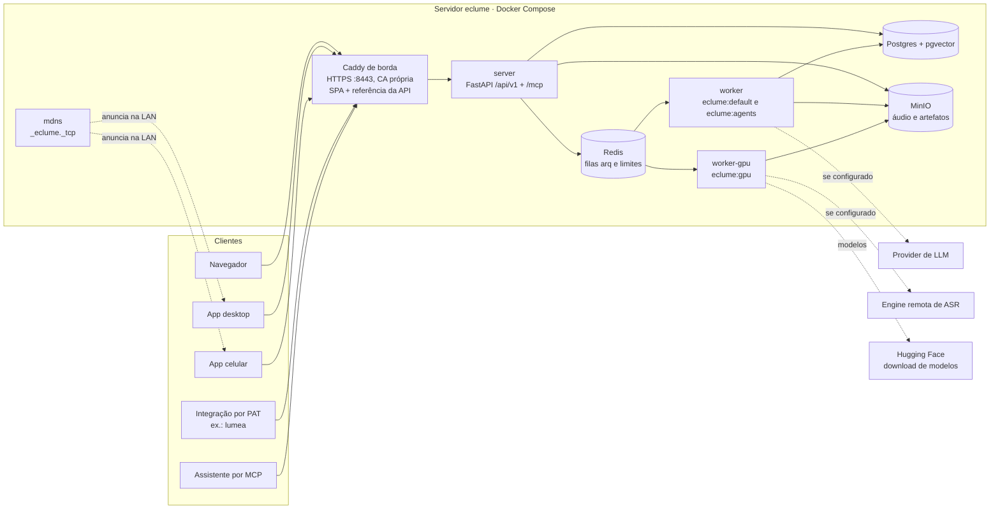

# Visão geral da arquitetura do eclume

O eclume é um servidor de transcrição que uma instituição hospeda numa máquina sua. Tudo roda num
Docker Compose; os clientes (navegador, apps e integrações) falam com uma única origem HTTPS, a do
Caddy. Este doc explica como as partes se encaixam. Ele não vincula: cada parte tem a sua norma, e
é ela que manda quando os dois divergirem.

## Os componentes

- **Caddy de borda** termina o TLS na porta 8443 com a CA própria do eclume, encaminha `/api`,
  `/mcp` e `/media` para o server, serve `/downloads` (a raiz da CA e os instaladores) de uma pasta
  e serve o resto, o **web**, da própria imagem (`eclume-edge`). O desenho
  concreto da produção, com volumes e portas, está em
  [deploy-producao.md](../../project/deploy-producao.md).
- **web** é o SPA em React embutido na borda, com a CSP das regras dele; o build também gera a
  **referência da API** (`/referencia-api.html`) do contrato
  ([contrato-v1.md](../../standards/api/contrato-v1.md), [frontend-web.md](../../standards/code/frontend-web.md)).
- **server** é a API `/api/v1` do contrato OpenAPI, o servidor MCP em `/mcp` no mesmo processo
  ([server-mcp-e-dispositivos.md](../../standards/code/server-mcp-e-dispositivos.md)), o painel
  admin em `/api/v1/admin` e o descritor público `GET /api/v1/server`
  ([server-nucleo.md](../../standards/code/server-nucleo.md), [server-admin.md](../../standards/code/server-admin.md)).
- **Workers** são processos arq sobre o Redis (abaixo): o `worker-gpu` e o `worker` CPU, que
  consome `eclume:default` e `eclume:agents` num processo só.
- **Postgres** com pgvector guarda contas, gravações, transcrições, embeddings e resumos, isolados
  por RLS. **Redis** guarda as filas, o heartbeat do worker GPU e os contadores de limite de
  tentativas. **MinIO** guarda o áudio, os uploads em partes e os artefatos da transcrição.
- **mdns** anuncia `_eclume._tcp` na rede local com a URL e a impressão digital da CA, para os apps
  acharem o servidor.
- **Clientes:** o navegador (sessão), o app desktop e o app celular (credencial de dispositivo),
  integrações como o lumea (PAT) e assistentes de IA pelo MCP (PAT com o grupo da tela "Conexão
  MCP"). Todos usam o mesmo contrato.

## As filas

Três filas arq no Redis, cada uma com o seu worker
([jobs-transcricao.md](../../standards/api/jobs-transcricao.md#filas)):

| Fila | Worker | O que roda |
|---|---|---|
| `eclume:gpu` | `worker-gpu`, um job por vez | `transcribe`: ASR, alinhamento, diarização e impressões de voz |
| `eclume:default` | `worker` | `ingest_transcript`, `transcription_failed`, purgas e os crons (reaper, retomada, despacho, uploads vencidos) |
| `eclume:agents` | `worker` (o mesmo processo), `ECLUME_AGENT_MAX_JOBS` vagas | `detect_agenda_type`, `fill_fields`, `summarize`, `summary_chat`, `base_chat` e `run_preview` |

A separação mantém a ingestão fora da espera por um agente, e a GPU com um job só. O despacho para
`eclume:gpu` é na vez da conta: cada conta tem no máximo um `transcribe` na fila, e o resto espera
retido no banco. O worker GPU não lê o banco: recebe tudo no job e devolve pelo bucket e por
`eclume:default`.

## O caminho de uma gravação

1. **Upload retomável.** O cliente converte o áudio para Opus mono quando pode
   ([formato-audio-upload.md](../../standards/code/formato-audio-upload.md)) e abre
   `POST /api/v1/uploads` com o hash do arquivo; o server deduplica pelo hash, confere as cotas e
   cria o multipart no MinIO. Cada parte vai por `PUT /api/v1/uploads/{id}/parts/{n}`, uma URL
   assinada da própria API; a retomada pergunta quais partes chegaram.
2. **Fila da GPU.** O `complete` grava a gravação e um job `queued`; o despacho o põe em
   `eclume:gpu` na vez da conta.
3. **Transcrição.** O `worker-gpu` baixa o áudio do MinIO, pré-processa, transcreve, alinha,
   diariza e grava `transcript.raw.json` e as impressões de voz no bucket.
4. **Ingestão.** O `worker` roda `ingest_transcript`: transcrição, busca full-text, embeddings
   e sugestões de pessoa por voz no Postgres; a biometria sai do bucket.
5. **Processamento automático.** A ingestão abre a cadeia por agente em `eclume:agents`: o tipo de
   agenda, os campos e o resumo pelo tipo, cada etapa registrada em `pipeline_steps`
   ([processamento-automatico.md](../../standards/code/processamento-automatico.md),
   [server-agentes.md](../../standards/code/server-agentes.md)).
6. **Leitura.** A web, os apps e as integrações leem a transcrição e o resumo pela API; as
   integrações sincronizam por `?since=` e o MCP expõe as mesmas operações como ferramentas.

## As fronteiras de confiança

- **Sessão do navegador.** Cookie `eclume_session` HttpOnly e Secure, com double-submit de CSRF
  (`X-CSRF-Token`) em todo método que muda estado.
- **PAT.** `Bearer eclp_…` com escopos escolhidos na criação; guardado só como SHA-256. Um
  `Authorization` presente nunca cai para o cookie.
- **Credencial de dispositivo.** O mesmo formato do PAT, de tipo `device`, nascida só do login ou
  do pareamento de um app; revogável na web.
- **Sessão de admin.** Conta e cookie próprios, `SameSite=Strict` e restritos a
  `/api/v1/admin`; nenhuma credencial de usuário tem poder de admin.
- **RLS por usuário.** Toda transação de requisição roda com o papel `eclume_app` e o
  `app.user_id` da conta; sem contexto, o banco não mostra nada.
- **CA fixada.** Os apps fixam a raiz da CA própria (conferida pelo `ca_sha256` do descritor, do
  QR, do instalador ou do mDNS confirmado) e não confiam nas raízes do sistema; a raiz própria tem
  restrição de nome, e a próxima raiz é anunciada em `ca_next_sha256` durante a rotação.
- **Segredos cifrados.** Chaves de provider e o token do Hugging Face ficam cifrados com
  AES-256-GCM (`ECLUME_ENCRYPTION_KEY`); o worker GPU recebe o token cifrado no job.
- **Limites.** Tentativas de login e pareamento por IP e por conta no Redis, e cotas por conta no
  upload e nos minutos de GPU.

## O que pode sair do servidor

Por padrão, o áudio e o texto ficam no servidor. Os pontos de saída possíveis são três, todos
ligados por configuração do admin:

- o **provider de LLM** de cada finalidade (resumos, campos, chat, detecção do tipo), que pode ser
  um serviço de fora, uma máquina da rede local ou o próprio servidor;
- a **engine remota de ASR** (`openai-compatible`), em vez da transcrição local;
- o **download de modelos** do Hugging Face pelo worker GPU (pesos, nunca áudio nem texto).

Para onde vai cada dado na configuração em vigor é a resposta de `GET /api/v1/privacy`, pública,
que a Conta, o cadastro e o painel admin mostram; o que cada provider exige está na matriz de
[server-agentes.md](../../standards/code/server-agentes.md#o-que-cada-provider-exige). Este doc
não repete a lista, para que as duas não divirjam.
