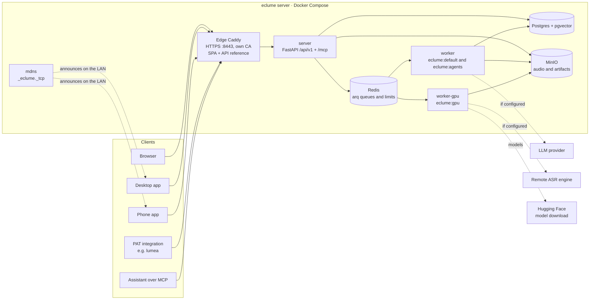

# eclume architecture overview

eclume is a transcription server that an institution hosts on its own machine. Everything runs in
a Docker Compose; the clients (browser, apps and integrations) talk to a single HTTPS origin, the
Caddy one. This doc explains how the parts fit together. It does not bind: each part has its own
standard, and that standard rules when the two diverge.

## The components

- **Edge Caddy** terminates TLS on port 8443 with eclume's own CA, forwards `/api`,
  `/mcp` and `/media` to the server, serves `/downloads` (the CA root and the installers) from a folder
  and serves the rest, the **web**, from its own image (`eclume-edge`). The concrete
  production design, with volumes and ports, is in
  [deploy-producao.md](../../project/deploy-producao.md).
- **web** is the React SPA embedded in the edge, with the CSP of its rules; the build also generates the
  **API reference** (`/referencia-api.html`) from the contract
  ([contrato-v1.md](../../standards/api/contrato-v1.md), [frontend-web.md](../../standards/code/frontend-web.md)).
- **server** is the `/api/v1` API of the OpenAPI contract, the MCP server at `/mcp` in the same process
  ([server-mcp-e-dispositivos.md](../../standards/code/server-mcp-e-dispositivos.md)), the
  admin panel at `/api/v1/admin` and the public descriptor `GET /api/v1/server`
  ([server-nucleo.md](../../standards/code/server-nucleo.md), [server-admin.md](../../standards/code/server-admin.md)).
- **Workers** are arq processes on Redis (below): the `worker-gpu` and the CPU `worker`, which
  consumes `eclume:default` and `eclume:agents` in a single process.
- **Postgres** with pgvector stores accounts, recordings, transcripts, embeddings and summaries, isolated
  by RLS. **Redis** stores the queues, the GPU worker heartbeat and the attempt-limit
  counters. **MinIO** stores the audio, the chunked uploads and the transcript artifacts.
- **mdns** announces `_eclume._tcp` on the local network with the URL and the CA fingerprint, so the apps
  can find the server.
- **Clients:** the browser (session), the desktop app and the phone app (device credential),
  integrations such as lumea (PAT) and AI assistants over MCP (PAT with the group from the "MCP
  Connection" screen). All use the same contract.

## The queues

Three arq queues on Redis, each with its own worker
([jobs-transcricao.md](../../standards/api/jobs-transcricao.md#filas)):

| Queue | Worker | What runs |
|---|---|---|
| `eclume:gpu` | `worker-gpu`, one job at a time | `transcribe`: ASR, alignment, diarization and voice fingerprints |
| `eclume:default` | `worker` | `ingest_transcript`, `transcription_failed`, purges and the crons (reaper, resume, dispatch, expired uploads) |
| `eclume:agents` | `worker` (the same process), `ECLUME_AGENT_MAX_JOBS` slots | `detect_agenda_type`, `fill_fields`, `summarize`, `summary_chat`, `base_chat` and `run_preview` |

The separation keeps ingestion out of the wait for an agent, and the GPU with a single job. Dispatch to
`eclume:gpu` is per account turn: each account has at most one `transcribe` in the queue, and the rest waits
held in the database. The GPU worker does not read the database: it receives everything in the job and returns it through the bucket and through
`eclume:default`.

## The path of a recording

1. **Resumable upload.** The client converts the audio to mono Opus when it can
   ([formato-audio-upload.md](../../standards/code/formato-audio-upload.md)) and opens
   `POST /api/v1/uploads` with the file hash; the server deduplicates by hash, checks the quotas and
   creates the multipart upload in MinIO. Each part goes through `PUT /api/v1/uploads/{id}/parts/{n}`, a signed
   URL of the API itself; resumption asks which parts arrived.
2. **GPU queue.** `complete` records the recording and a `queued` job; dispatch puts it in
   `eclume:gpu` on the account's turn.
3. **Transcription.** The `worker-gpu` downloads the audio from MinIO, preprocesses, transcribes, aligns,
   diarizes and writes `transcript.raw.json` and the voice fingerprints to the bucket.
4. **Ingestion.** The `worker` runs `ingest_transcript`: transcript, full-text search, embeddings
   and voice-based person suggestions into Postgres; the biometrics leave the bucket.
5. **Automatic processing.** Ingestion opens the agent chain in `eclume:agents`: the agenda
   type, the fields and the summary by type, each step recorded in `pipeline_steps`
   ([processamento-automatico.md](../../standards/code/processamento-automatico.md),
   [server-agentes.md](../../standards/code/server-agentes.md)).
6. **Reading.** The web, the apps and the integrations read the transcript and the summary through the API;
   integrations sync through `?since=` and the MCP exposes the same operations as tools.

## The trust boundaries

- **Browser session.** `eclume_session` cookie, HttpOnly and Secure, with a CSRF double-submit
  (`X-CSRF-Token`) on every state-changing method.
- **PAT.** `Bearer eclp_…` with scopes chosen at creation; stored only as SHA-256. A present
  `Authorization` never falls back to the cookie.
- **Device credential.** The same format as the PAT, of type `device`, born only from the login or
  the pairing of an app; revocable in the web.
- **Admin session.** Its own account and cookie, `SameSite=Strict` and restricted to
  `/api/v1/admin`; no user credential has admin power.
- **RLS per user.** Every request transaction runs with the `eclume_app` role and the account's
  `app.user_id`; without context, the database shows nothing.
- **Pinned CA.** The apps pin the root of the own CA (checked against the `ca_sha256` of the descriptor, the
  QR, the installer or the confirmed mDNS) and do not trust the system roots; the own root has a name
  constraint, and the next root is announced in `ca_next_sha256` during rotation.
- **Encrypted secrets.** Provider keys and the Hugging Face token are stored encrypted with
  AES-256-GCM (`ECLUME_ENCRYPTION_KEY`); the GPU worker receives the encrypted token in the job.
- **Limits.** Login and pairing attempts per IP and per account in Redis, and per-account quotas on
  upload and GPU minutes.

## What can leave the server

By default, the audio and the text stay on the server. There are three possible exit points, all
enabled by admin configuration:

- the **LLM provider** of each purpose (summaries, fields, chat, type detection), which can be
  an outside service, a machine on the local network or the server itself;
- the **remote ASR engine** (`openai-compatible`), instead of local transcription;
- the **model download** from Hugging Face by the GPU worker (weights, never audio or text).

Where each piece of data goes in the configuration in force is the answer of `GET /api/v1/privacy`, public,
which the Account, the sign-up and the admin panel show; what each provider requires is in the matrix of
[server-agentes.md](../../standards/code/server-agentes.md#o-que-cada-provider-exige). This doc
does not repeat the list, so the two do not diverge.
